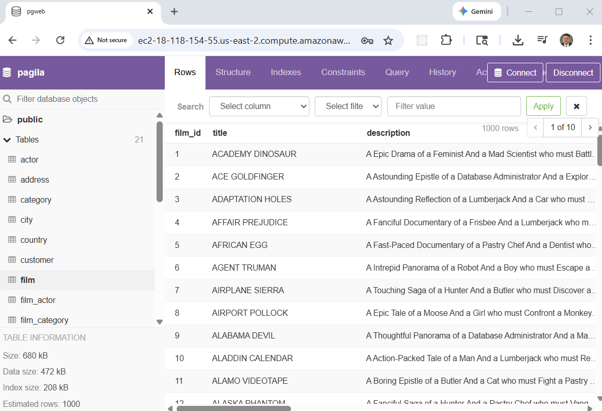
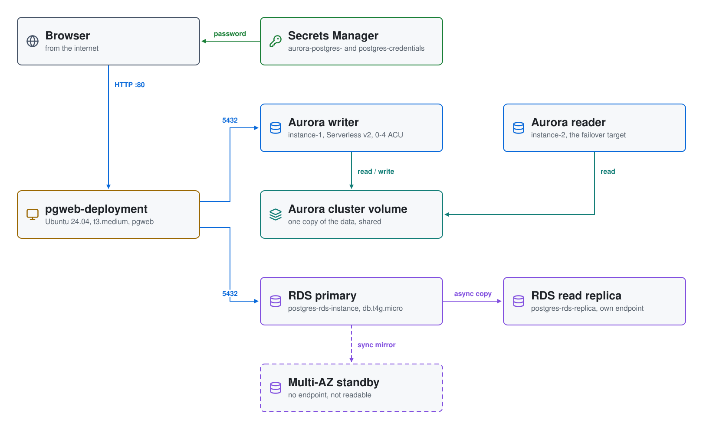
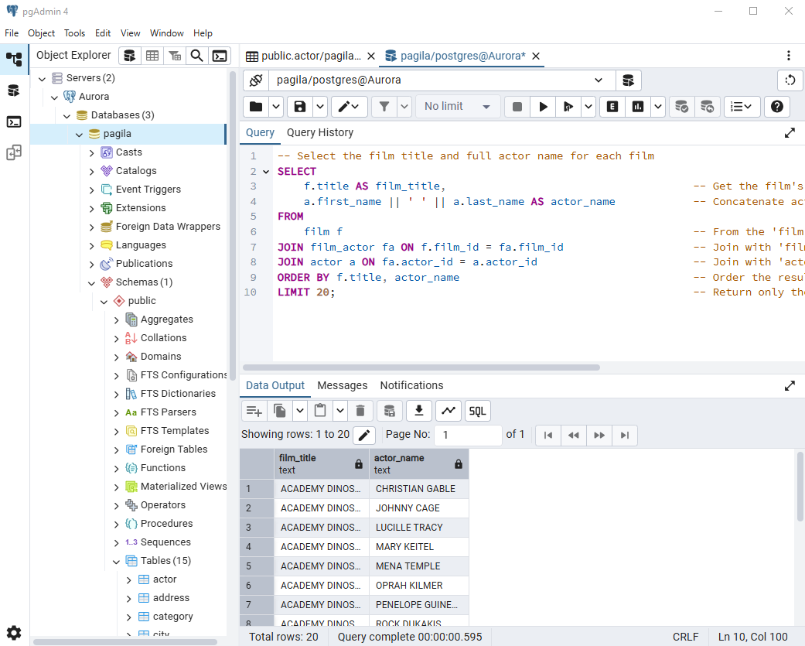

# PostgreSQL on AWS: Amazon RDS and Aurora, side by side

Both of AWS's managed PostgreSQL engines, built from one Terraform stack and
loaded with the same data. **Amazon RDS for PostgreSQL** runs as a Multi-AZ
primary with a read replica; **Aurora PostgreSQL** runs as a Serverless v2
cluster with a writer and a reader. A **pgweb** host gives you a browser
client for both, and both are loaded with the
[Pagila](https://www.postgresql.org/ftp/projects/pgFoundry/dbsamples/pagila/) sample database, so you can
compare them on the same queries.



| Piece | Where | Role |
|---|---|---|
| **RDS primary** | `rds-subnet-1`/`-2` | `postgres-rds-instance`, `db.t4g.micro`, 20 GB gp3, Multi-AZ, Performance Insights |
| **Multi-AZ standby** | the other AZ | synchronous copy of the primary; no endpoint |
| **RDS read replica** | `rds-subnet-1`/`-2` | `postgres-rds-replica`, asynchronous copy with its own endpoint |
| **Aurora cluster** | `rds-subnet-1`/`-2` | `aurora-postgres-cluster`, Serverless v2 (0–4 ACU, pauses after 5 idle minutes), writer `aurora-postgres-instance-1`, reader `aurora-postgres-instance-2` |
| **pgweb-deployment** | `rds-subnet-1` | Ubuntu 24.04, `t3.medium`; loads Pagila into both engines, then serves pgweb on port 80 |
| **Secrets Manager** | regional | `postgres-credentials` and `aurora-postgres-credentials`: user, password, endpoint |

## Architecture

<picture>
  <source media="(prefers-color-scheme: dark)" srcset="architecture-dark.svg">
  
</picture>

Regenerate with `python3 make_diagram.py`.

- **`01-rds/`** is the whole stack: the VPC (`rds-vpc`, 10.0.0.0/24) with two
  public subnets (`rds-subnet-1` in us-east-2a, `rds-subnet-2` in us-east-2b),
  the security groups, both database engines, the credentials in Secrets
  Manager, and the pgweb host.
- **`01-rds/data/`** holds the Pagila load scripts (`pagila-db.sql`,
  `pagila-schema.sql`, `pagila-data.sql`) and the sample queries.

## How the two engines differ

| | RDS for PostgreSQL | Aurora PostgreSQL |
|---|---|---|
| Copies of the data | three: primary, standby, replica | one cluster volume, shared by every instance |
| What you can read | the primary and the replica, each on its own endpoint | the writer on the cluster endpoint, the reader on the reader endpoint |
| The standby | real and billed, but no endpoint and not readable | none: the reader is the failover target |
| Compute | fixed instance class (`db.t4g.micro`) | Serverless v2, 0–4 ACU; pauses after 5 idle minutes |

### When the writer fails

| Action | Engine | What happens |
|---|---|---|
| **Failover** (`aws rds failover-db-cluster`) | Aurora | The reader and the writer trade places. The cluster endpoint follows the new writer. Nothing to copy, and it's reversible: fail over again to swap back. |
| **Reboot with failover** (`aws rds reboot-db-instance --force-failover`) | RDS | The standby takes over. The endpoint name stays the same, and a new standby is built behind it. |
| **Promote** (`aws rds promote-read-replica`) | RDS | The replica breaks off into its own database. Replication stops for good; there's no un-promote. |

## How it boots

1. Terraform builds the network, both engines and the secrets, generating a
   24-character password for each engine's `postgres` user.
2. The pgweb host installs the PostgreSQL client, clones this repository, and
   loads Pagila into both engines' writer endpoints with `psql`. Progress is
   in `/root/db_load.log`.
3. It installs pgweb 0.17.0 as a systemd service on port 80. pgweb starts
   without a connection; you pick the engine when you connect.

## Security groups

```
internet ─80───▶ pgweb-deployment
internet ─5432─▶ RDS primary, read replica, Aurora writer and reader
```

Both groups (`http-sg` and `rds-sg`) allow `0.0.0.0/0`. Every database is
publicly accessible, so you can also connect a local client such as pgAdmin
or `psql` to any endpoint with the `postgres` password.

## Prerequisites

* [An AWS Account](https://aws.amazon.com/console/)
* [Install AWS CLI](https://docs.aws.amazon.com/cli/latest/userguide/getting-started-install.html)
* [Install Terraform](https://developer.hashicorp.com/terraform/install)
* [Install jq](https://jqlang.github.io/jq/download/)

If this is your first time watching our content, we recommend starting with
this video: [AWS + Terraform: Easy Setup](https://youtu.be/BCMQo0CB9wk).

## Deploy

```bash
git clone https://github.com/mamonaco1973/aws-postgres.git
cd aws-postgres
./apply.sh       # one phase: VPC, RDS, Aurora, secrets, pgweb host
```

Everything deploys to `us-east-2`. `apply.sh` ends by running `validate.sh`,
which prints the pgweb URL and both writer endpoints:

```
==========================================================================
 PROJECT ENDPOINTS
==========================================================================

 PGWEB Application:
   http://ec2-203-0-113-10.us-east-2.compute.amazonaws.com

 RDS Instance:
   postgres-rds-instance.abc123xyz.us-east-2.rds.amazonaws.com

 Aurora Instance:
   aurora-postgres-cluster.cluster-abc123xyz.us-east-2.rds.amazonaws.com

==========================================================================
```

## Try it

1. Get an engine's password:

   ```bash
   aws secretsmanager get-secret-value --secret-id postgres-credentials \
     --query SecretString --output text | jq -r .password
   ```

   Use `aurora-postgres-credentials` for Aurora. The user is `postgres` for
   both.

2. Open the pgweb URL and connect with the engine's endpoint from
   `validate.sh`, user `postgres`, that password, database `pagila`, and SSL
   mode `require`. Disconnect and connect again to switch engines.
3. Run the same queries on both engines (`01-rds/data/`):

   ```sql
   SELECT
       f.title AS film_title,
       a.first_name || ' ' || a.last_name AS actor_name
   FROM film f
   JOIN film_actor fa ON f.film_id = fa.film_id
   JOIN actor a ON fa.actor_id = a.actor_id
   ORDER BY f.title, actor_name
   LIMIT 20;
   ```

   ```sql
   SELECT
       f.title,
       STRING_AGG(a.first_name || ' ' || a.last_name, ', ') AS actor_names
   FROM film f
   JOIN film_actor fa ON f.film_id = fa.film_id
   JOIN actor a ON fa.actor_id = a.actor_id
   GROUP BY f.title
   ORDER BY f.title
   LIMIT 10;
   ```

4. Optionally, connect pgAdmin from your own machine the same way:

   

5. Try a failover from the table above, then reconnect.

## Troubleshooting

| Symptom | Fix |
|---|---|
| pgweb doesn't load | The host is still loading Pagila. `aws ssm start-session --target <instance-id>`, then `sudo tail /root/db_load.log` and `systemctl status pgweb`. |
| `pagila` is missing | Check `/root/db_load.log` for the `psql` output. |
| The first Aurora connection after a quiet spell is slow | The Aurora instances pause after 5 idle minutes at 0 ACU; the first connection resumes them. |
| pgweb can't connect | Set SSL mode to `require`, and use the password from that engine's secret; the two engines have different passwords. |

## Teardown

```bash
./destroy.sh     # destroys the whole stack; no final snapshots, secrets deleted immediately
```

## Notes

- **Lab only.** The databases and pgweb are open to the internet, pgweb runs
  over plain HTTP with no sign-in of its own, and the admin passwords are in
  the host's user data. The host's IAM role also has `AmazonSSMFullAccess`.
  Put the databases in private subnets and restrict the security groups for
  anything more.
